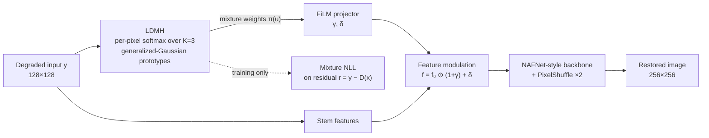

<div align="center">

# Local Distribution Mixture Head for Semiconductor Inspection Image Restoration

**A controlled study: matched controls, eight seeds, Holm-corrected statistics and equivalence tests.**


[Key results](#key-results) · [Method](#method) · [Quick start](#quick-start) · [Protocol](#experimental-protocol) · [Reproduce](#reproducing-the-manuscript) · [Limitations](#limitations) · [Citation](#citation)

</div>

---

## Overview

Restoration networks are usually trained with a loss that assumes one fixed residual distribution everywhere in the image. This repository tests a different idea on degraded semiconductor inspection images: estimate a **local mixture of generalized-Gaussian shapes** for every pixel and use it both as a likelihood loss and as a conditioning signal (FiLM) for a compact restoration network. We call the module the **Local Distribution Mixture Head (LDMH)**.

The study is built to give a trustworthy answer rather than a flattering one:

- every comparison has a **capacity-matched control** and a **scale-only control**;
- up to **eight seeds** per arm, with the seed (not the image) as the unit of replication;
- a **declared primary family** of contrasts with Holm correction, and **TOST equivalence tests** for claims of no effect;
- a **100-epoch check** and a **transfer test** on a stronger backbone.

> [!IMPORTANT]
> **Headline.** LDMH improves a compact backbone by **+0.087 dB** over its matched control at 30 epochs (8 seeds, Holm p = 0.0003). The gain **does not persist** at 100 epochs (−0.030 dB) and is **equivalent to zero** on a Restormer backbone (−0.007 dB). We therefore present LDMH as a module that speeds up early training of compact models, not as a lasting improvement.

---

## Key results

**Setting.** 2× restoration (128×128 → 256×256) of speckle (fitted looks *L* = 9.26) plus Gaussian (σ = 0.0425) degraded images. 3,200 KLA pairs split 2,560 / 320 / 320 (seed 42). Metric: test PSNR (dB) on the 320 held-out images.

### Main comparison (30 epochs)

| Arm | Seeds | Params | Test PSNR (mean ± SD) |
|:--|:-:|--:|--:|
| Baseline | 6 | 86,945 | 27.658 ± 0.047 |
| + Global generalized-Charbonnier loss | 4 | 86,945 | 27.642 ± 0.060 |
| Scale-only control | 8 | 115,490 | 27.661 ± 0.032 |
| FiLM control (no mixture) | 8 | 116,138 | 27.687 ± 0.036 |
| **Full LDMH** | 8 | 116,138 | **27.773 ± 0.020** |

### Pre-declared contrasts

| Tier | Contrast | n | Δ PSNR (dB) | 95% CI | Holm p |
|:--|:--|:-:|--:|:--|--:|
| Primary | Full − FiLM control, 30 ep | 8 v 8 | **+0.087** | [+0.054, +0.119] | **0.0003** |
| Primary | Full − FiLM control, 100 ep | 3 v 3 | −0.030 | [−0.064, +0.004] | 0.13 |
| Primary | Restormer LDMH − FiLM control | 4 v 4 | −0.007 | [−0.052, +0.037] | 0.68 · equivalent (±0.05 dB) |
| Secondary | Full − Baseline | 8 v 6 | +0.115 | [+0.066, +0.165] | 0.0034 |
| Secondary | Full − Scale-only | 8 v 8 | +0.112 | [+0.083, +0.142] | < 0.001 |
| Secondary | Full − Global GC | 8 v 4 | +0.132 | [+0.039, +0.225] | 0.038 |

### What the evidence supports

| Finding | Status |
|:--|:--|
| LDMH beats a capacity-matched control at 30 epochs | ✅ Supported (small effect, well powered: MDE 0.045 dB) |
| The shape mixture beats a scale-only head | ✅ Supported on KLA |
| The advantage persists with longer training | ❌ Not supported |
| LDMH transfers to a stronger backbone (Restormer) | ❌ Not supported (equivalent) |
| Stabilizing components (sigmoid bound, diversity and balance penalties) are needed | ❌ Not supported (≤ 0.001 dB) |
| Improves defect detection (synthetic defects, real SEM masks) | ❌ Not supported |
| Gain comes from *local* conditioning rather than the likelihood objective | ⏳ Not yet established (`global_mix` control provided) |

<details>
<summary><b>Statistical diagnosis of the residual (manuscript Section IV)</b></summary>

<br>

The pooled residual is heavy-tailed (GGD shape β = 0.80), but a **signal-dependent Gaussian** with variance σ²(*I*) = *a·I*² + *b* reproduces the heavy pooled tails, the spread of patch-level shape estimates and their correlations with edge density, local variance and entropy. The data therefore do **not** show that the residual *shape* varies beyond signal-dependent scale. A right-censored observation model is also rejected: degraded values are not clipped at a fixed ceiling.

</details>

<details>
<summary><b>External compact baselines (same protocol, 4 seeds)</b></summary>

<br>

| Model | Params | Test PSNR (dB) |
|:--|--:|--:|
| NAFNet-small | 112,817 | 27.684 |
| Full LDMH (ours) | 116,138 | 27.773 |
| SwinIR-small | 100,813 | 27.852 |
| Restormer-small | 111,917 | 27.923 |
| Restormer + FiLM control | 141,110 | 27.959 ± 0.030 |
| Restormer + LDMH | 141,110 | 27.952 ± 0.016 |

These are compact re-implementations, not the released networks. No efficiency or state-of-the-art claim is made.

</details>

---

## Method



- **LDMH.** Two conv blocks and a 1×1 head give *K* = 3 logits per pixel; a temperature-scaled softmax (*T* = 1.5) gives the mixture weights π(*u*). The *K* prototypes (shape β<sub>k</sub> ∈ (0.3, 2.5) through a sigmoid, scale α<sub>k</sub> through a softplus) are shared across pixels.
- **Likelihood loss.** `L_NLL = −(1/N) Σ log Σ_k π_k(u) f(r(u); β_k, α_k)`, with *r* the input residual. Combined with a Charbonnier reconstruction loss and diversity and balance penalties.
- **FiLM conditioning.** The weight map π(*u*) is projected to per-channel scale and shift that modulate the stem features before the restoration blocks.
- At test time only the degraded input is needed.

---

## Quick start

> [!NOTE]
> The KLA image pairs are **not** included. They were provided through the KLA hackathon challenge and are governed by the provider's terms.

**Requirements.** One CUDA GPU (a 30-epoch run takes about 26 minutes on a Tesla T4), Python 3.10+.

```bash
pip install torch numpy scipy pandas matplotlib scikit-image pillow
```

**Data.**

| Dataset | Source | Expected layout |
|:--|:--|:--|
| KLA pairs | Hackathon challenge (not redistributed) | `GT/` clean images and `NoisyLR/` degraded inputs, `.npy` files with matching names |
| Carinthia-S (optional) | [Zenodo 10.5281/zenodo.16895427](https://doi.org/10.5281/zenodo.16895427) · CC BY 4.0 | a folder containing `images/` and `masks/` |

**Run.**

1. Open `q1_next_experiments.ipynb` on a GPU.
2. In **Part 1**, set `SESSION`, `SEEDS` and `SESSION_HOURS` (the session plan in that cell lists the arms per letter).
3. Choose **Run All**. Training is resumable: finished runs are skipped and a session stops cleanly at the time limit.
4. Download `results_latest.zip`, add it as an input to the next session, change `SESSION` and run again.

> [!TIP]
> On Kaggle use **Commit** (Save Version → Save & Run All). An interactive session loses `/kaggle/working` when it ends; a committed version keeps its output.

---

## Repository contents

| File | Purpose |
|:--|:--|
| `q1_next_experiments.ipynb` | Main notebook: data audit, residual statistics, models, training driver, all arms, confirmatory analysis, downstream tests, efficiency, claims ledger, reviewer-requested controls (Part 13) |
| `master-file-2.ipynb` | Earlier consolidated notebook with the same model and training code |
| `carinthia_eval_only.ipynb` | Scores saved checkpoints on Carinthia-S (real SEM images, synthetic degradation); no training |
| `train_domain2_only.ipynb` | Trains the second noise domain (Poisson–Gaussian) only |
| `recovered_test_psnr_seeds.csv` | Per-seed test PSNR for every arm, including seeds recovered from training logs |
| `carinthia_s_selection.csv` · `carinthia_s_manifest.json` | The 300 Carinthia-S images used and the selection rule |

---

## Experimental protocol

| Item | Setting |
|:--|:--|
| Split | Random by file name, 2,560 / 320 / 320, seed 42; manifest SHA-1 `31d7258b…` stored with the results. Validation used only for checkpoint selection; test evaluated once |
| Training (all arms) | 30 epochs · AdamW, lr 2e-4 · cosine schedule · mixed precision · gradient clipping · batch size 8 · flip and 90° rotation augmentation (train only) · best-validation checkpoint |
| Long schedule | FiLM control and full model, 100 epochs, seeds 0–2 |
| Degradation (self-generated tests) | `y = D(x·s + n)`: unit-mean speckle `s ~ Gamma(L, 1/L)`, Gaussian `n ~ N(0, σ²)`, 2×2 area average `D`, in that order |
| Unit of replication | The **seed**. Welch test on seed means, 95% interval |
| Multiplicity | Holm within a declared primary tier (3 contrasts) and a secondary tier |
| No-effect claims | TOST equivalence, margin ±0.05 dB, 90% interval |
| Power | Minimum detectable effect at 80% power; Hedges *g* |

**Arms.** Baseline, global GC, FiLM control, scale-only, full; hard-clamp, no-balance and no-diversity variants; NAFNet-small, SwinIR-small, Restormer-small; Restormer with a FiLM control and with LDMH.

<details>
<summary><b>Reviewer-requested controls (Part 13 of the notebook)</b></summary>

<br>

- **`global_mix`**: same architecture, parameter count, FiLM pathway and loss as the full model, but the mixture weights are a learned vector that does **not** depend on the input. `full − global_mix` isolates the effect of *local* conditioning; `global_mix − film_control` isolates the likelihood objective. Set `GLOBAL_MIX_NOW = True` to train seeds 0–7.
- **Split audit**: for every validation and test image, the highest normalized correlation with any training image, to check for near-duplicates across splits. Needs no GPU; writes `split_leakage_audit.csv`.

</details>

---

## Outputs

Each run writes `runs/<arm>/seed<k>/` with `best.pth`, `history.csv`, `test_per_image.csv` and `results.json`. Analysis cells write `tables/` and `figures/`, including `summary_by_model.csv`, `table_ablation_main.csv`, `table_external_main.csv`, `table_downstream.csv`, `table_robustness_paired_tests.csv`, `table_efficiency.csv`, `degradation_fit.json` and `section4_summary.json`. A **claims ledger** applies fixed rules and prints `SUPPORTED`, `NOT SUPPORTED` or `NOT RUN` for each claim.

## Reproducing the manuscript

| Manuscript item | Source |
|:--|:--|
| Section IV statistics (Tables I–II, Figs 1–3) | Part 4; `section4_summary.json` |
| Tables IV–V (main results, contrasts) | Part 9F confirmatory analysis |
| Table VI, Fig. 7 (100-epoch schedule) | Long-schedule arms (session C) |
| Tables VII–VIII (Restormer transfer, external baselines) | External arms; `table_external_main.csv` |
| Tables IX–X (degradation types, Carinthia-S) | `carinthia_eval_only.ipynb`; `table_robustness_paired_tests.csv` |
| Table XI (claim status) | Part 12 claims ledger |

---

## Limitations

- The degradation is **synthetic**. No natively noisy SEM pairs were evaluated, so transfer to real acquisitions is untested.
- The 100-epoch comparison has three seeds per arm and cannot rule out a small effect of either sign; the Restormer transfer has four.
- The baseline has six seeds and global GC four, because some sessions ended before all seeds finished.
- Checkpoints from seeds 4–7 were lost when interactive sessions closed, so downstream evaluations (HP-Err, Carinthia-S, robustness) use seeds 0–3 for every arm.
- The full model and its control differ in **training objective** as well as conditioning; the `global_mix` control addresses this and has not yet been run.
- The split is random by pair with no wafer, die or lot identifiers, so overlap between splits cannot be excluded; the split-audit cell checks this.
- NAFNet, SwinIR and Restormer are compact re-implementations (about 100,000–140,000 parameters).
- Efficiency was measured on one GPU type.

---

## Data and licence

- **KLA data**: not included; governed by the provider's terms.
- **Carinthia-S**: CC BY 4.0 (Kofler and Hasić, Zenodo, DOI [10.5281/zenodo.16895427](https://doi.org/10.5281/zenodo.16895427)).
- **Code**: MIT licence (add a `LICENSE` file to the repository).

## Citation

```bibtex
@unpublished{kumar2026ldmh,
  author = {Kumar, Golu},
  title  = {Distribution-Adaptive Restoration of Degraded Semiconductor Inspection Images:
            A Controlled Study of a Local Distribution Mixture Head},
  year   = {2026},
  note   = {Manuscript under review}
}
```

Replace this entry with the journal reference once the paper is published.

## Acknowledgements and contact

The author thanks KLA Corporation for the hackathon problem and the image data. This work was done independently and received no institutional or external funding.

**Golu Kumar** · [golukumar.research01@gmail.com](mailto:golukumar.research01@gmail.com)
